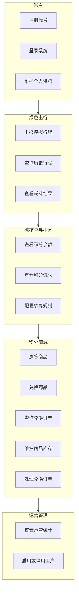

# 用户故事地图

## 1. 用户活动主线

用户完成一次绿色出行激励的核心路径为：

`账户接入 → 上报出行 → 查看减排与积分 → 兑换商品 → 运营维护`

## 2. 故事分层

| 层次 | 账户 | 绿色出行 | 碳核算与积分 | 积分商城 | 运营管理 |
| --- | --- | --- | --- | --- | --- |
| 主干活动 | 注册、登录 | 上报行程、查询行程 | 查看减排结果、查看积分 | 浏览商品、兑换商品 | 规则、库存、订单和统计 |
| P0 故事 | US-01、US-02 | US-04、US-05、US-06 | US-07、US-08、US-16 | US-09、US-10、US-11、US-12、US-13 | US-17及规则与商品运营 |
| P1 故事 | US-03、US-15 | 无独立新增故事 | 无独立新增故事 | 无独立新增故事 | US-14 |
| 验收关注 | 身份与权限 | 数据校验与防重复 | 计算可追溯、账实一致 | 余额与库存一致性 | 可审计、可运营 |

## 3. 用户故事与验收条件

### US-01 注册账号

作为新用户，我希望注册账号，以便使用绿色出行积分服务。

验收条件：

- 用户名唯一，密码使用带盐密码哈希保存，不保存明文。
- 注册成功后获得普通用户角色。
- 用户名、密码或必填资料不合法时给出明确提示。

### US-02 登录系统

作为用户，我希望登录系统，以便访问个人行程、积分和兑换记录。

验收条件：

- 正确凭据可以登录，错误凭据不能建立会话。
- 登录后只能访问当前角色授权的功能。
- 停用用户不能建立有效会话。

### US-03 维护个人资料

作为用户，我希望查看和修改个人资料，以便保持信息准确。

验收条件：

- 用户只能修改自己的资料。
- 用户名和角色不能由普通用户自行修改。

### US-04 上报模拟行程

作为用户，我希望上报一条公交、地铁、骑行或步行行程，以便获得碳减排反馈。

验收条件：

- 必须选择支持的出行方式，填写大于零的里程和有效的起止时间。
- 系统展示基准排放、实际排放、碳减排量和积分。
- 使用 `userId + clientTripId` 识别重复请求；相同键、相同业务输入返回已有结果，相同键、不同业务输入拒绝。
- 规则按行程结束时间匹配，保存起终点、因子、积分系数和计算时间快照；详见 BR-01 至 BR-04。

### US-05 查询历史行程

作为用户，我希望查看自己的历史行程，以便了解绿色出行情况。

验收条件：

- 只显示当前用户的记录。
- 可按出行方式和时间范围筛选。
- 每条记录显示计算使用的规则版本或可追溯标识。

### US-06 查看减排结果

作为用户，我希望查看一次行程的计算依据，以便理解积分来源。

验收条件：

- 展示里程、出行方式、基准排放因子、实际排放因子、减排量、积分和计算时间。
- 历史行程继续显示当时的规则快照，不随新规则改变。

### US-07 查看积分余额

作为用户，我希望查看当前可用积分，以便决定是否兑换商品。

验收条件：

- 余额不能为负数。
- 余额等于该用户所有有效积分流水的汇总。

### US-08 查看积分流水

作为用户，我希望查看每笔积分的增加和扣减，以便核对账户变化。

验收条件：

- 流水包含业务类型、关联行程或订单、变动积分、变动后余额和时间。
- 流水只追加，不允许普通用户修改或删除。

### US-09 浏览商品

作为用户，我希望浏览积分商城商品，以便选择兑换目标。

验收条件：

- 只显示已上架商品。
- 展示商品名称、所需积分、库存和所属商户。
- 缺货商品有明确状态。

### US-10 兑换商品

作为用户，我希望使用积分兑换商品，以便把绿色行为转化为实际权益。

验收条件：

- 余额和库存充足时，积分、库存、积分流水和兑换订单同时成功。
- 余额不足、库存不足或重复提交时，不出现部分扣减。

### US-11 查询兑换订单

作为用户，我希望查看兑换订单，以便了解商品处理进度。

验收条件：

- 用户只能查看自己的订单。
- 订单展示商品、数量、消耗积分、状态和创建时间。

### US-12 维护商品与库存

作为运营管理员，我希望代商户维护商品和库存，以便持续提供兑换权益。

验收条件：

- 商品具有所属商户、积分价格、库存和上下架状态。
- 库存不能小于零。
- 商品下架后不能被新兑换。

### US-13 处理兑换订单

作为运营管理员，我希望更新订单状态，以便完成订单履约。

验收条件：

- 只允许 `CREATED → FULFILLED` 或 `CREATED → CANCELLED`；只有运营管理员可执行。
- 取消时全额返还原扣积分并恢复原数量库存，同时追加唯一冲正流水；重复取消不再次返还。
- 状态变更记录操作人、时间和原状态。

### US-14 查看运营统计

作为运营人员，我希望查看出行与兑换统计，以便评估激励效果。

验收条件：

- 统计总行程数、总减排量、发放积分、兑换次数和库存告警。
- 统计结果与明细记录可核对；商户汇总只统计指定期间已履约订单，不涉及货币结算。

### US-15 启用或停用用户

作为运营人员，我希望启用或停用异常用户，以便控制平台风险。

验收条件：

- 停用用户不能登录、上报行程或兑换商品。
- 停用操作记录操作人、原因和时间。

### US-16 配置碳核算规则

作为运营管理员，我希望配置碳排放因子和积分系数，以便调整激励规则且保留历史依据。

验收条件：

- 数值非负、版本唯一，同方式规则的生效区间不重叠，区间使用左闭右开语义。
- 规则由行程结束时间匹配；无匹配规则时整笔上报失败，不生成行程、流水或余额变化。
- 已发布规则的因子不可覆盖；切换时结束旧区间并新增版本，禁止追溯生效，历史快照不变。
- 记录操作人、时间、变更前后值及原因。

### US-17 核对积分账目

作为运营管理员，我希望核对积分账户与业务流水，以便发现积分发放、扣减和冲正差异。

验收条件：

- 对同一一致性快照，逐用户比较余额与流水合计，并核对每条流水的累计余额。
- 核对非零积分成功行程的发放流水、全部订单的原扣减流水和已取消订单的冲正流水。
- 差异显示用户或业务编号、期望值、实际值；核对操作只读，不自动改余额或删除流水。
- 正常业务应无差异；发现差异时记录问题，修复须另行评审并保留审计证据。

## 4. 发布切片

| 切片 | 用户价值 | 包含故事 |
| --- | --- | --- |
| Sprint 1 | 用户可以注册、登录并进入空行程列表 | US-01、US-02、US-03、US-15 |
| Sprint 2 | 用户可以上报行程并获得可追溯积分 | US-04、US-05、US-06、US-07、US-08、US-16 |
| Sprint 3 | 用户可以兑换商品，运营人员可管理商城 | US-09、US-10、US-11、US-12、US-13、US-14、US-17 |
| Sprint 4 | 系统可测试、可部署、可演示 | 全部 P0 故事和必要的 P1 故事 |
